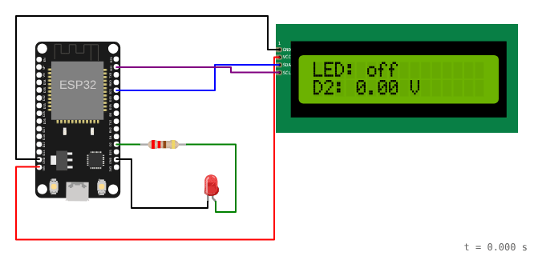
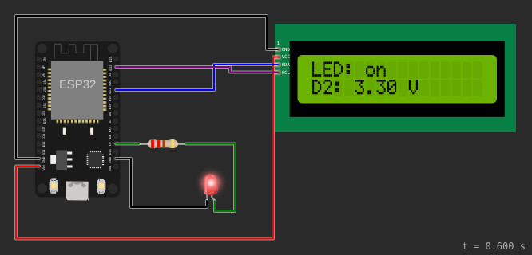
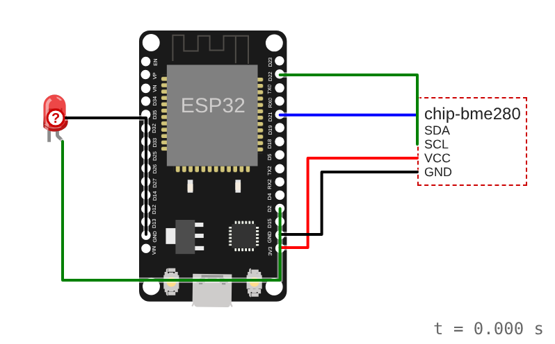

# render

Draws a Wokwi `diagram.json` with [wokwi-elements], plays back sim state from
a trace file, and exports PNG screenshots and MP4 or GIF video.



Each wire has a light edge, so black wires show on dark parts. In dark mode,
the circuit is on a dark grey panel:



## Setup

```sh
cd render
npm install
```

Video export needs `ffmpeg` on the `PATH`. Capture uses the Chromium that
Playwright downloads (`npx playwright install chromium`), or the one at
`CHROMIUM_PATH` if you set it. `nix develop` sets it for you.

## Capture

```sh
# One PNG for each --png, at the time of the matching --at (seconds).
node capture.js examples/blink/diagram.json --trace examples/blink/trace.json \
  --png off.png --at 0 --png on.png --at 0.6

# Video from --start to --end (default: the trace end). Use .mp4 or .gif.
node capture.js examples/blink/diagram.json --trace examples/blink/trace.json \
  --video blink.mp4 --fps 20
```

`--scale` sets the device pixel ratio (default 2). Parts with `"hide": true`
show greyed out. Give `--no-hidden` to leave them out. Give `--dark` to
draw the circuit on the dark grey panel that the viewer uses in dark mode.

## Interactive viewer

Serve this folder with a static file server, then open
`viewer.html?diagram=<path>&trace=<path>`:

```sh
python3 -m http.server
# http://localhost:8000/viewer.html?diagram=examples/blink/diagram.json&trace=examples/blink/trace.json
```

## Use in your own page

`src/` is plain ES modules for the browser, with no build step. Load the
wokwi-elements bundle first.

```html
<script src="https://cdn.jsdelivr.net/npm/@wokwi/elements@1.9.2/dist/wokwi-elements.bundle.min.js"></script>
<div id="circuit"></div>
<script type="module">
  import {renderCircuit} from './src/circuit.js';
  const circuit = await renderCircuit(document.getElementById('circuit'), diagram);
  circuit.elements.get('led1').value = true;  // Map of part id to element.
  await circuit.setTime(trace, 0.5);           // Show the trace state at 0.5 s.
</script>
```

## Trace format

```json
{
  "version": 1,
  "end": 2.0,
  "parts": {
    "led1": [{"t": 0, "value": false}, {"t": 0.5, "value": true, "brightness": 0.8}],
    "lcd1": [{"t": 0, "text": "Hello"}]
  }
}
```

The sim core writes this format. The renderer ignores its optional `probes`
key. Each key frame sets properties of the part's wokwi element. A property keeps
its value until a later key frame changes it. Times are in seconds.

## Diagram support

- Parts: any `type` that is a wokwi-elements tag, for example `wokwi-led` or
  `wokwi-esp32-devkit-v1`. `src/parts.js` draws the types that
  wokwi-elements does not have: `wokwi-vcc`, `wokwi-gnd`, `spice-capacitor`,
  `spice-diode`, `spice-npn` and the boards `board-esp32-devkit-c-v4`,
  `board-esp32-s3-devkitc-1`, `board-esp32-c3-devkitm-1` and
  `board-esp32-c6-devkitc-1`. The boards use Wokwi's pin names and pin
  positions, so Wokwi diagrams keep their wires. Their drawings in
  `src/boards/` are from [ESPboards](https://www.espboards.dev/), under
  CC BY-NC 4.0, so pages and pictures that show them must credit ESPboards
  and must not be for commercial use. Other types show as a dashed box, with
  a labeled pin on its edge for each wire.
- A wire to a pin that the part does not have ends at the part center, with a
  red "?" badge. The renderer logs a warning for each unknown part and pin.

  
- `wokwi-slide-potentiometer` gets `max` 1023, because the sim gives pot
  values as 0..1023.
- A `wokwi-led-bar-graph` segment with a value between 0 and 1 shows dim,
  as a `wokwi-led` does.
- `top`, `left`, `rotate` and `attrs` are supported.
- Parts with `"hide": true` are still in the sim, so they and their wires
  show greyed out. The viewer has a "Show hidden parts" toggle, and pages can
  call `circuit.showHidden(false)`.
- Wires follow the Wokwi `h`, `v` and `*` moves. An empty color hides a wire.

[wokwi-elements]: https://github.com/wokwi/wokwi-elements
